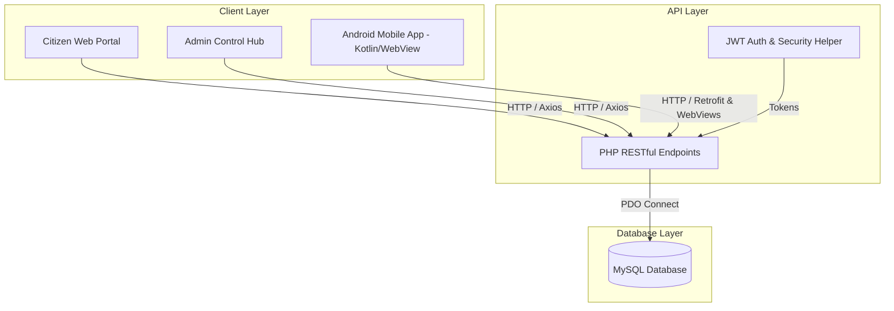

# 🛡️ SafeReach: System Architecture & Technical Stack Documentation

SafeReach is a premium emergency ambulance response system designed to streamline SOS dispatches, track paramedic telemetry, coordinate hospital bed allocations, and manage emergency medical teams in real-time.

---

## 🏗️ 1. High-Level Architecture Overview

SafeReach uses a client-server topology that binds Web, Mobile, and Database layers together over a local area network interface:

---

## 🌐 2. Frontend Technology Stack (Web Application)

The user dashboard interfaces are responsive single-page applications built for real-time interaction:

* **Core Framework:** **React.js** (Version 18+) written in **TypeScript (TSX)**.
* **Build Engine:** **Vite** (extremely fast compilation, hot module replacement, and bundling).
* **Styling & Layout:** **Tailwind CSS** + Custom **Vanilla CSS Glassmorphism** styled for a modern, neon dark-theme matching native Android dark modes.
* **Maps & Telemetry Tracking:**
  * **Google Maps JavaScript API:** Renders interactive maps, plots live coordinates, calculates trip routes (using Directions Services), and tracks moving paramedic markers.
  * **OpenStreetMap (Overpass API):** Integrated in the backend/frontend to dynamically lookup, query, and sort real hospitals within a 15km radius of the user's coordinates globally.
* **State & Authentication:** React Context API (`AuthContext.tsx`) for global user state, loading progressors, and system toasts.
* **HTTP Requests:** **Axios** client configured with interceptors to automatically append JWT bearer headers.

---

## ⚙️ 3. Backend Technology Stack (RESTful APIs)

The backend handles all business logic, routing state transitions, and database queries:

* **Core Engine:** **PHP 8** (procedural & object-oriented endpoints serving JSON payloads).
* **Server Stack:** **Apache HTTP Server** (hosted locally via **XAMPP**).
* **Database Driver:** **PDO (PHP Data Objects)** with prepared statements to secure the server against SQL Injection.
* **Authentication & Credentials:** **JWT (JSON Web Tokens)** containing payload variables (User ID, Name, Role) signed with a secure secret key to authorize calls.
* **Response Helper:** A unified `Response::send(success, message, data, code)` wrapper ensuring consistent JSON return structures.

---

## 🗄️ 4. Database Schema Design (MySQL)

All data is normalized and stored inside local relational tables:

| Table Name | Primary Purpose / Columns |
| :--- | :--- |
| **`users`** | Accounts for Citizens, Paramedics, and Admins. Stores credentials, hashed passwords, phones, profile photos, and role identifiers. |
| **`emergency_requests`** | Stores dispatches, patient names, pickup coords (`lat/lng`), status (`pending`, `accepted`, `arrived`, `boarded`, `completed`, `cancelled`), assigned vehicles, and timestamp audit logs. |
| **`ambulances`** | Fleet inventory. Stores driver user IDs, vehicle plate numbers, license credentials, experience metrics, availability status, and current GPS coordinates. |
| **`hospitals`** | Hospital network register. Stores names, addresses, phone hotlines, geographic coordinates, and real-time available ICU / NICU bed vacancy numbers. |
| **`patient_vitals`** | Telemetry logs. Stores heart rate, blood pressure, oxygen saturation, temperature readings, and patient condition flags. |
| **`notifications`** | System-wide alerts and notification cards. |
| **`request_feedback`** | Patient reviews containing rating metrics (1-5 stars) and audit comments. |

---

## 📱 5. Mobile Application Stack (Android)

Designed to deliver the emergency portal directly onto physical mobile devices:

* **Language:** **Kotlin** (compiled inside **Android Studio**).
* **UI toolkit:** **Jetpack Compose** (modern native layout engine).
* **Hybrid Core:** Embeds a secure, full-screen **Jetpack WebKit WebView** that loads the React Web Application directly. This guarantees 100% layout and theme synchronization.
* **Hardware GPS Integration:** Bridges native Android Location Services (`ACCESS_FINE_LOCATION`) directly into the WebView so browser components can track real GPS positions.
* **Network client:** **Retrofit 2** with **Gson Converter** for native authentication and profile data synchronization.

---

## 🧪 6. Testing & Quality Assurance Suite

The repository is pre-configured with two automated QA suites:

1. **Selenium Web Tests:** Automated browser tests (written in Python/Java) that run through citizen signups, admin logins, hospital additions, and ambulance allocations.
2. **Appium Mobile Tests:** Automated Android emulator tests that compile the Kotlin APK, launch it, grant location permissions, and verify native WebView transitions.
3. **Audit Log Reports:** A collection of 1,800+ automated execution logs and bug-tracker spreadsheets cataloging edge-case resolutions.
